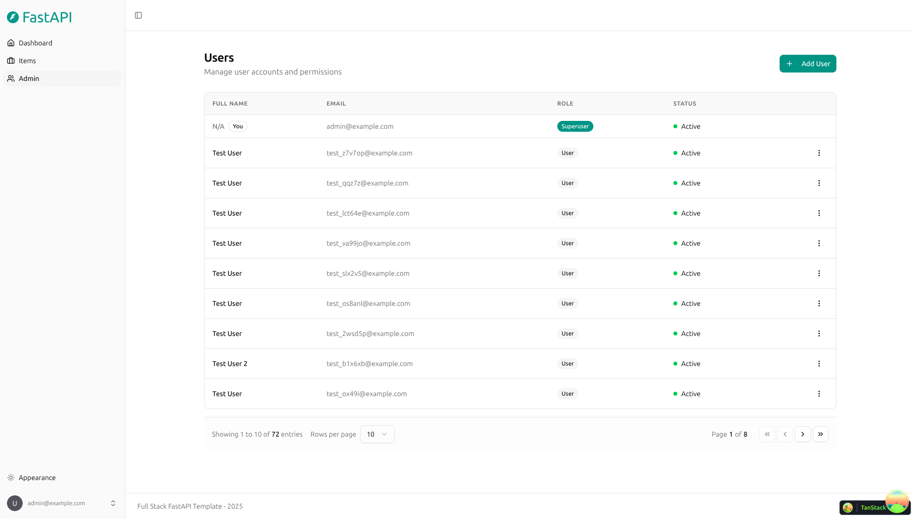
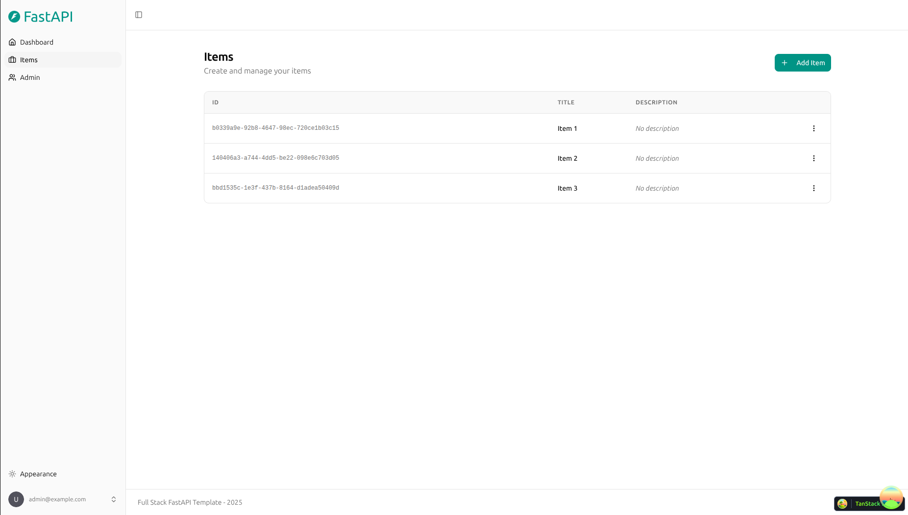
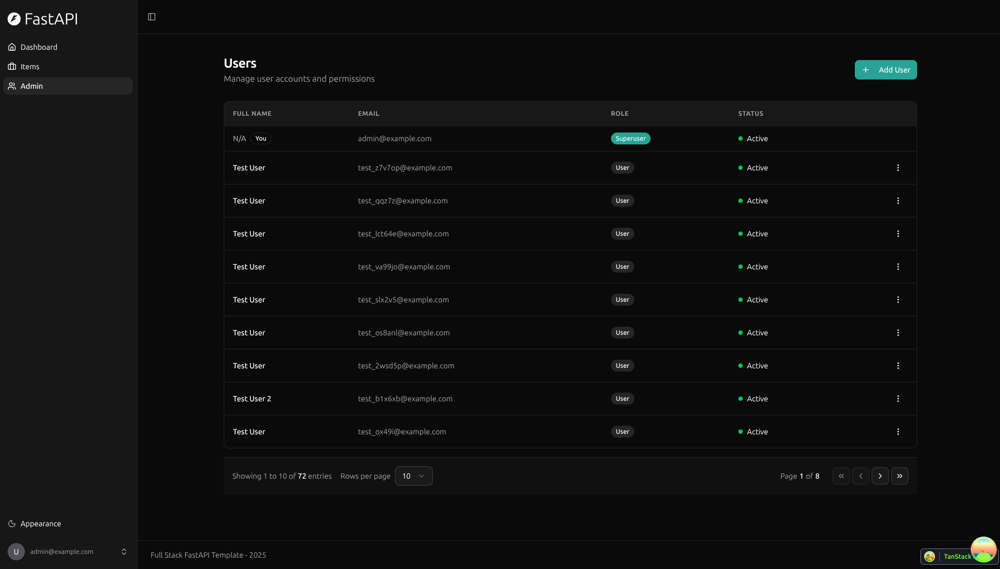

# Full Stack Django Template

[](../../actions/workflows/test-docker-compose.yml)
[](../../actions/workflows/test-backend.yml)
[](../../actions/workflows/playwright.yml)

The standard starting point for new projects: a Django + Django Ninja API with a server-rendered React frontend, ported from the [Full Stack FastAPI Template](https://github.com/fastapi/full-stack-fastapi-template). The backend serves the exact same HTTP API as the original, and the generated frontend client is byte-identical.

```
example.com/api/*            → backend: Django Ninja API
example.com/django-admin/*   → backend: Django admin
example.com/*                → frontend: TanStack Start (SSR public pages + React app)
cdn.example.com              → object storage: static files, media uploads, frontend assets
```

## Technology Stack and Features

- 🐍 [**Django**](https://www.djangoproject.com) for the Python backend.
  - ⚡ [Django Ninja](https://django-ninja.dev) for the typed REST API and OpenAPI schema.
  - 🔍 [Pydantic](https://docs.pydantic.dev) for API schemas and settings management.
  - 💾 [PostgreSQL](https://www.postgresql.org) as the SQL database, with Django migrations.
  - 🪣 [django-storages](https://django-storages.readthedocs.io) for static and media files in S3-compatible object storage behind a CDN: Django never serves files.
  - 🛠️ Django admin at `/django-admin` for superusers, themed with [Unfold](https://unfoldadmin.com). (`/admin` is the React app's user management page.)
- 🚀 [React](https://react.dev) for the frontend.
  - 🌐 [TanStack Start](https://tanstack.com/start) server-side rendering for public pages, with per-page SEO meta tags, `robots.txt` and `sitemap.xml`. The logged-in app renders in the browser.
  - 💃 Using TypeScript, hooks, [Vite](https://vitejs.dev), and other parts of a modern frontend stack.
  - 🎨 [Tailwind CSS](https://tailwindcss.com) and [shadcn/ui](https://ui.shadcn.com) for the frontend components.
  - 🤖 An automatically generated frontend client, checked in CI.
  - 🧪 [Playwright](https://playwright.dev) for end-to-end testing.
  - 🦇 Dark mode support.
- 🐋 [Docker Compose](https://www.docker.com) for local services and self-hosted deployment.
  - 📞 [nginx](https://nginx.org): each project runs an nginx gateway on a single port (routes `/api` to Django, everything else to the frontend), behind one shared server nginx for all your projects (HTTPS with certbot).
- 🔒 Argon2 password hashing, with automatic upgrade of older hashes on login.
- 🔑 JWT (JSON Web Token) authentication.
- 📫 Email-based password recovery with single-use links.
- ✉️ [React Email](https://react.email) for email templates.
- 📬 [Mailpit](https://mailpit.axllent.org) for local email testing during development.
- ✅ Tests with [Pytest](https://pytest.org) and pytest-django.
- 🏭 CI (continuous integration) and CD (continuous deployment) based on GitHub Actions.

### Dashboard Login


### Dashboard - Admin



### Dashboard - Items



### Dashboard - Dark Mode



### React Email Templates


### Mailpit - Local Email Testing


## Starting a New Project from This Template

1. Click **Use this template** on GitHub (mark this repository as a *Template repository* in its settings first), or copy the repository.
2. In `.env`, set `PROJECT_NAME` and, for anything other than local development, real values for `SECRET_KEY`, `POSTGRES_PASSWORD` and `FIRST_SUPERUSER_PASSWORD`. Generate them with:

   ```bash
   python -c "import secrets; print(secrets.token_urlsafe(32))"
   ```

3. Update the page titles (`frontend/src/routes`), `frontend/index.html`, the logo in `frontend/public/assets/images` and the footer.
4. Keep or remove the **Items** example (see below), then start building.
5. For deployment, set the GitHub Actions variables and secrets listed in [deployment-docker-compose.md](./deployment-docker-compose.md).

### The Items Example

`backend/app/items` is the reference implementation of the full pattern: model → migration → Ninja schemas → router → tests → frontend page. Copy it for new resources.

To remove it: delete `backend/app/items`, its entry in `INSTALLED_APPS` (`backend/app/settings.py`) and its router in `backend/app/api.py`, delete `backend/tests/api/routes/test_items.py` and `backend/tests/utils/item.py`, regenerate the client, and remove the Items page and components from the frontend (`frontend/src/routes/_layout/items.tsx`, `frontend/src/components/Items`, the sidebar entry, `frontend/tests/items.spec.ts`).

## API Contract Rules

The frontend client in `frontend/src/client` is generated from the backend's OpenAPI schema. To keep it predictable:

- **Router tag → Service name.** `Router(tags=["users"])` becomes `UsersService`.
- **View function name → SDK method name.** `def read_user_me(...)` in the `users` router becomes `UsersService.readUserMe` (operation id `users-read_user_me`).
- **Schema class name → TypeScript type name.** Use plain `ninja.Schema` classes with explicit names (`UserPublic`, `ItemsPublic`), not `ModelSchema`.
- **Errors** are `{"detail": "message"}` (`raise HttpError(400, "message")`), validation errors are `422` `{"detail": [{"loc", "msg", "type"}]}`.
- **Lists** take `skip` / `limit` query parameters and return `{"data": [...], "count": n}`.
- **Regenerate the client after every API change**: `bash scripts/generate-client.sh`. The *Check Frontend Client* workflow fails if you forget.

`backend/app/core/openapi.py` adapts Ninja's schema to the conventions above (operation ids, `OAuth2PasswordBearer` security scheme, `422` responses, `Body_*` form bodies).

## Backend Development

Backend docs: [backend/README.md](./backend/README.md).

## Frontend Development

Frontend docs: [frontend/README.md](./frontend/README.md).

## Deployment

Self-hosted deployment with Docker Compose: [deployment-docker-compose.md](./deployment-docker-compose.md).

## Development

General development docs: [development.md](./development.md).

This includes the local Django and Vite workflow, Docker Compose services, `.env` configuration, and more.

## License

Licensed under the terms of the MIT license. Based on the Full Stack FastAPI Template by Sebastián Ramírez, also MIT licensed.
